# 02. Economy & game loop

## 1. Purpose
Owns the Night / Round / Quota structure, the gangster debt curve, the Stream income model, the scratch fine, and the single `Shop` catalog every Cash sink hangs off — sold by the Bartender NPC (§3.6).
Rewritten against 06 D4/D7 as amended by P2 (no roles, free-roam bar), P3 (Bartender NPC is the Shop), P5 (income sheet below), P16 (scratch fine, §3.8) and P17 (the Bartender's random Drinks shelf and fixed Upgrades, §3.6).

## 2. Concepts & data model

### `NightConfig` (`Resource`) — `src/gameplay/economy/night_config.gd`
| field | type | value / note |
|---|---|---|
| `night_number` | `int` | 1–5 campaign, 6+ endless |
| `quota` | `int` | Cash owed at Night end (§3.4) |
| `rounds_count` | `int` | `3` |
| `round_time_limit_sec` | `float` | `120.0 [tune]` — sized for ~10 shots at a 12 s cycle |
| `object_ball_count` | `int` | `10 [tune]` — 11 bodies with the cue ball, inside P1's `≤ 12` phone budget |
| `base_viewers` | `int` | Stream starts here every Night (§3.3) |
| `hazard_tiers` | `Array[int]` | `[0, 1, 2]` — one entry per Round, the tier the crew may pick from |
| `unlocked_ball_types` | `Array[StringName]` | the Night's own drop pool (the five .tres: `red_basic` + `black_penalty`, plus `stone_ball` on Nights 3 and 4 — one per rack, inside the 12-ball cap, 06 P8); `EconomyManager.round_config()` adds what the Shop unlocked, not the Night number |

### `RoundState` (`RefCounted`)
`round_index: int`, `time_remaining: float`, `shots_taken: int`, `balls_remaining: int` (positive-value only), `round_points: int`, `active_event_id: StringName`.

### `StreamState` (`RefCounted`)
`viewers: int`, `hype: float` `[0,1]`, `total_tips: int`. **No `viewer_multiplier` field** — there is exactly one `Viewer_Scalar`, the formula in §3.2, computed on demand. Nothing else in the project may define a second one.

### `CameraRig` (`Node3D`)
`camera_id: StringName`, `tier: int` (1–3), `tier_mult()` = `1.0 / 1.25 / 1.5 [tune]` (a const table on the rig — a separate `CameraSpec` resource would hold nothing else), `held_by: int`. Rigs are physical props: any player can walk up and drag one (P2). No `view_angle_tag` — the angle is wherever the friend left it, and it is scored at pot time (§3.2). Tripod model (06 P14): splayed legs + centre column (dark metal), matte body, lens barrel with a glass front, a red tally light — one merged `ArrayMesh`, 3 surfaces (metal / matte / glass+tally palette) = 3 draw calls, `gi_mode` DYNAMIC (no UV2); the view is scored by math, never rendered (07).

### `CueSpec` (`Resource`) — upgrade target, not a player design
01's fields: `power_cap_speed_mps`, `spin_offset_radius`, `jump_unlocked`, `masse_unlocked`, `wobble_reduction`. `EconomyManager.build_cue_spec()` folds the owned cue items over the defaults (power `×(1+Σ)`, spin `×(1+Σ)`) and sets `PhysicsSim.active_cue`; the Player module decides how a phone gesture drives it.

### `ShopItem` (`Resource`) — one catalog, owned by 02
| field | type | note |
|---|---|---|
| `id` | `StringName` | unique |
| `display_name`, `description` | `String` | what the Bartender's menu prints (a Drink's come from its `Drink`, 03 §2.4) |
| `category` | `StringName` | `"drink" \| "ball" \| "cue" \| "camera" \| "table"` |
| `cost_cash` | `int` | §3.6 |
| `payload` | `Resource` | `Drink` (03) for drinks; otherwise the unlock/stat delta |
| `min_night` | `int` | gate |
| `one_per_night` | `bool` | |
| `persistent` | `bool` | survives a wipe into the next run (§3.7) |
| `max_owned` | `int` | copies one run may hold; `1` for upgrades, `2` for `spare_tripod` (2 base + 2 = the 4-rig cap), `0` = repeatable (drinks) |

Non-drink `payload` is an `ItemDelta` (`src/gameplay/economy/item_delta.gd`): cue / ball-pool / ball-value / camera / table-`Effect` / stream deltas, folded over everything owned. The 16 Upgrades rows below are `.tres` under `src/resources/shop/`; each Drink is a `ShopItem` synthesised from the 03 catalog by `ShopCatalog` (price = `Drink.cost_cash`) but only reachable through the Bartender's shelf (§3.6).

### `DrinkTier` — `src/gameplay/economy/drink_tier.gd` (06 P17)
`enum Tier {COMMON, UNCOMMON, RARE, EPIC, LEGENDARY, MYSTERY}` with the three constant tables the shelf and the menu share:

| tier | draw weight | units per offer | frame colour |
|---|---:|---:|---|
| Common | 50 | 3 | `#B8BEC6` |
| Uncommon | 26 | 2 | `#4CC46A` |
| Rare | 13 | 1 | `#3D8BFF` |
| Epic | 6 | 1 | `#A64DFF` |
| Legendary | 2 | 1 | `#FFB020` |
| Mystery | 3 | 1 | `#FF2A3C`, glitching text |

`Drink.tier` (03 §2.4) puts each Drink on one rung. Every tier holds at least 3 Drinks, Mystery at least 4 (03 §3.5).
### `EconomyState` (`RefCounted`) + `SaveProfile` (04)
`shared_cash: int` (**may be negative**, §3.8), `quota_remaining: int`, `nights_survived: int`, `owned_items: Array[StringName]`, `persistent_unlocks: Array[StringName]`, `stock_key`/`stock_ids`/`stock_left` (the Bartender's shelf, §3.6).

---

## 3. Rules & formulas

### 3.1 Session structure
1 Night = 3 Rounds. A Round is 120 s of wall clock, **ends on the timer, not on the rack** — "table cleared" (every `base_value > 0` ball potted) ends it early with the remaining seconds banked as nothing; it is a flex, not the goal. Stuck states (only penalty balls left, or the cue ball frozen) end the Round early with no penalty, per D5.

One `Shot` at a time; the shooter passes to the next player in seat order when their shot resolves. **The other three players are not assigned jobs** (D3 reversed by P2): they free-roam the bar — buy and throw drinks, grab a `CameraRig` and reframe it, bump the table for a `table_tilt` nudge, work the jukebox. Every one of those is an 03 `Effect` with `owner_peer_id`, fired by world interaction. The Director, Bartender and Hype fictions all still happen; they emerge from who walks where.

Rounds differ by hazard tier: **Round 1 no Event, Round 2 a tier-1 Event, Round 3 a tier-2 Event**, chosen by the crew from 03's catalog before the Round starts (D6 — chosen, never rolled). Identical rounds are a UI boundary pretending to be pacing.

**Intermission is untimed.** The host advances it. Negotiating what the shared purse buys is the social peak of the loop; a 15 s clock means the host buys alone.

```mermaid
stateDiagram-v2
    [*] --> Lobby
    Lobby --> NightStart: host starts session
    NightStart --> Intermission: load NightConfig, viewers = base_viewers
    Intermission --> RoundSetup: host advances (untimed; Bartender open)
    RoundSetup --> RoundActive: crew picks Event for tier, drop 10 balls (seeded)

    state RoundActive {
        [*] --> AwaitingShot
        AwaitingShot --> ShotInMotion: shooter strikes
        ShotInMotion --> ScoringShot: all balls at rest
        ScoringShot --> AwaitingShot: next shooter
    }

    RoundActive --> RoundEnd: timer expired / table cleared / shots exhausted
    RoundEnd --> Intermission: rounds remaining
    RoundEnd --> Reckoning: round 3 done

    state Reckoning {
        [*] --> EvaluateQuota
        EvaluateQuota --> NightSuccess: Cash >= demand
        EvaluateQuota --> GameOver: Cash < demand
    }

    NightSuccess --> Victory: Night 5 buyout paid
    NightSuccess --> NightStart: next NightConfig
    GameOver --> [*]: persistent unlocks kept
    Victory --> [*]
```



### 3.2 Shot reward
```
Shot_Cash = (Raw_Points × Trick_Mult) × Camera_Mult × Event_Mult × Viewer_Scalar × Point_To_Cash_Rate
```
- `Raw_Points` — sum of `BallType.base_value` for balls potted this shot, emitted by `PhysicsSim` (01). Penalty balls carry it negative.
- `Trick_Mult` — the **single highest** trick multiplier detected on this shot (D5, never a sum). Mean over a Night ≈ `1.15 [tune]`.
- `Camera_Mult` — `(1.0 + (tier_mult - 1.0) × view_quality) × stream_camera_bonus_mult`, where the winning rig is the one with the **best auto-scored view of the pocket the ball dropped into** (P2): `view_quality = clamp(occlusion_clear × distance_falloff × facing_dot, 0, 1)`, best score across all rigs wins. Cameras matter because friends move them, not because a menu says so. Implementation (`camera_scorer.gd`): the ray runs eye → pocket (+15 cm) and **ignores the balls' bodies** (walls, props and players are cover); `distance_falloff` = 1 inside 3 m, linear to 0 at 12 m `[tune]`; `facing_dot` = rig forward · direction to the pocket, floored at 0. The scored pocket is the one the Shot's highest-value ball fell in (`GameLoop` tracks it; a foul scores none → 1.0).
- `Event_Mult` — 03's `Reward = Drink_Mult × Event_Mult`, caps `2.0 / 3.0`.
- `Viewer_Scalar` — **the one definition**: `1.0 + (viewers / 500.0) × (0.5 + 0.5 × hype)`.
- `Point_To_Cash_Rate` — `0.3 [tune]` ($3 per 10 points). This is the single knob that moves every Night's ratio together; tune the curve with §3.4's table, not with this.

**Penalty balls ride the same stack, deliberately.** `black_penalty` at −250 costs $141 on Night 1 and $398 on Night 5 (arithmetic in §3.5). Stacking drinks and hazards for a big pot means stacking the cost of a bad one — it is the best risk mechanic in the design, so it is a rule, not an oversight.

### 3.3 Viewers and hype
Viewers **reset to `NightConfig.base_viewers` at the start of every Night** and grow only within it: `+25` per pot, `+100` on a trick pot, `−50` on a foul, plus `−0.3 hype` on a foul (a scratch or off-table foul also costs Cash, §3.8). There is **no idle viewer decay** — hype decays (`−0.05/s`, floors at 0), viewers do not. Under free-roam the table is never idle anyway, and a decay clock punishes the negotiation that Intermission exists for.

Every 500-viewer milestone rolls a tip ($25–$150 `[tune]`) straight into Cash. Base viewers per Night are the crew's reputation, and the only thing that raises them out-of-band is the `stream_overlay` table mod (§3.6).

### 3.4 Quota curve and the reckoning
Quota is `×1.5` per Night, sized to ~60% of modelled income (§3.5).

| Night | Quota | `base_viewers` | Hazard tiers (R1/R2/R3) | Gangster |
|---|---:|---:|---|---|
| 1 | $600 | 100 | — / 1 / 2 | polite text |
| 2 | $900 | 250 | — / 1 / 2 | enforcer at the door, on stream |
| 3 | $1,350 | 450 | — / 1 / 2 | cuts the table lights mid-Round |
| 4 | $2,000 | 700 | — / 1 / 2 | sits at the bar all Night |
| 5 | $3,000 | 1,000 | — / 1 / 2 | Final Reckoning |

- **Night 5 demand = the Buyout = `1.5 × Quota_5` = $4,500.** It replaces Quota_5 rather than adding to it, so there is one number on screen. Night 5's own income models at $4,304 (§3.5), which means the last night is the only one the bank must not be empty for — every Intermission purchase from Night 1 onward is a bet against that $200-ish gap. Bank after Night 4 at baseline is ~$2,734, so the buyout is comfortably reachable and comfortably spendable away.
- **Miss the demand and the run ends. There is no interest band.** D4 allowed either `≤10%` interest or a hard fail; hard fail wins because the 70% band was a delayed loss dressed as mercy (miss by 30% on Night 1, need 143% on Night 2), because a debt spiral is a group punishment four players can no longer act on, and because §3.7's persistent unlocks already carry the run's value forward. A 45-minute run that ends cleanly is better than one that is dead ten minutes before it stops.
- Overpay is kept: leftover Cash banks into the next Night.
- **Endless (Night 6+):** quota `×1.6` per Night — strictly above the campaign's `×1.5`, because endless must never be an easier tutorial. `base_viewers` continues at `+300/Night`, hazard tiers become `1 / 2 / 3`, and the drop pool keeps every gimmick ball the crew ever bought. Built by `NightConfig.endless(night5, n)` (quota = Night 5's `3000 × 1.6^k`, so Night 6 = $4,800 — not the $4,500 Buyout) and cached in `GameLoop.night_at()`; the host enters it with **Endless** on the won-campaign screen (`advance()` from `CAMPAIGN_WON`). No Buyout after Night 5.

### 3.5 Income sheet (P5)
Assumptions, held flat across the campaign so the curve is the only variable: 3 Rounds × 10 shots = 30 shots/Night, **60% of shots pot** → **18 pots/Night**; `Trick_Mult` mean `1.15` (≈25% of pots are tricks); `hype` mean `0.6`; mean viewers = `base_viewers + 300` (18 pots grow the count ~+590 over a Night, so the mean sits ~halfway); mean ball value rises only as the crew buys ball upgrades; camera and event means rise as tiers are bought and hazards escalate. **No drinks are counted** — drinks are the upside on top of every row below.

```
Income = pots × Mean_Ball_Value × Trick_Mult × Camera_Mult × Event_Mult × Viewer_Scalar × Rate
Night 1: Viewer_Scalar = 1 + (400 / 500) × (0.5 + 0.5 × 0.6) = 1 + 0.8 × 0.8 = 1.64
         18 × 100 × 1.15 × 1.00 × 1.00 × 1.64 = 3,395 points × 0.3 = $1,018
```
Every other row is the same six multiplications; only the five columns change.

| Night | Pots | Mean ball value | Trick mult | Camera mult | Event mult | Mean viewers | Viewer scalar | Points | Income | Quota | **Ratio** |
|---|---:|---:|---:|---:|---:|---:|---:|---:|---:|---:|---:|
| 1 | 18 | 100 | 1.15 | 1.00 | 1.00 | 400 | 1.64 | 3,395 | $1,018 | $600 | **1.70** |
| 2 | 18 | 110 | 1.15 | 1.05 | 1.10 | 550 | 1.88 | 4,944 | $1,483 | $900 | **1.65** |
| 3 | 18 | 120 | 1.15 | 1.10 | 1.15 | 750 | 2.20 | 6,913 | $2,074 | $1,350 | **1.54** |
| 4 | 18 | 135 | 1.15 | 1.15 | 1.20 | 1,000 | 2.60 | 10,027 | $3,008 | $2,000 | **1.50** |
| 5 | 18 | 150 | 1.15 | 1.20 | 1.25 | 1,300 | 3.08 | 14,345 | $4,304 | $3,000 | **1.43** |

Campaign total: income $11,887, quotas $7,850, surplus $4,037 — the Shop's whole budget, minus the buyout draw. Ratio drifts 1.70 → 1.43 on purpose: the crew is never safe, but Night 1 forgives a bad rack. Income grows 4.2× while quota grows 5.1×, which is the D4 failure (income affine, quota superlinear) reduced to a 4.7%/Night drift instead of a cliff.

Multiplier stack at the extremes: Night 1 `1.15 × 1.00 × 1.00 × 1.64 = 1.89` (a −250 black costs **$141**); Night 5 `1.15 × 1.20 × 1.25 × 3.08 = 5.31` (the same ball costs **$398**, and with drinks capped at 2.0 on top, up to $797).

### 3.6 The Bartender (P3, refined by P17)
Every Cash sink in the game is a `ShopItem` in one catalog, sold by the Bartender NPC behind the counter. **There is no Shop button and no separate shop screen:** `Player.interact()` on the counter opens one menu, `BartenderMenu` (a `ui_modal`, 08 §4), with two tabs.

**Drinks — a random shelf of 5 offers (P17).** The host rolls it at every `intermission_started` (`EconomyManager.roll_stock(GameLoop.stock_key())`):
1. For each of the 5 offers, draw a tier by `DrinkTier` weight (Common 50 · Uncommon 26 · Rare 13 · Epic 6 · Legendary 2 · Mystery 3), then a Drink of that tier chosen uniformly. **No Drink appears twice in one stock**; a tier with no Drink left is skipped, so a stock is always 5 distinct Drinks.
2. Each offer carries its tier's units (Common 3 · Uncommon 2 · Rare/Epic/Legendary/Mystery 1), **shared by the whole crew**: every sale takes one unit for everyone. A sold-out offer stays on the shelf, greyed, so the crew sees what it missed.
3. The roll is a pure function of `stock_key = hash(campaign_seed, night, round_index, salt)` (`DrinkStock.roll`), so a resume reproduces it. The shelf also rides the checkpoint (`SaveProfile.stock_*`, 04 §2.6): `restore()` puts it back with its sold-out counts and the Intermission that follows keeps it when the key matches. `update_stock` (04 §5) mirrors it to every client after the roll, each sale, a restore and a `full_state`. A new campaign (`wipe()`) empties it.

Each card shows the tier-coloured frame, name, a one-line description, **every effect as a line — buff in green, debuff in red** (`StatText`, 03 §2.2), the price and the units left. **Mystery** cards are red with glitching text and always show at least one buff and one debuff, so the buyer decides whether the buff is worth the cost (03 §3.5). The menu keeps the old counter's two modes: **Serve** (buy it for a crewmate, with a crew target row) and **Throw** (03 §3.7). Throwing buys the Drink off the same shelf (`EconomyManager.try_throw`: stock, then Cash) and nobody drinks it.

**Upgrades — the fixed rows.** The 16 ball / cue / camera / table rows, listed with a name, a description and a state (Buy / Locked / Owned / Can't afford / Between Rounds).

| id | cat | cost `[tune]` | effect |
|---|---|---:|---|
| *(03 catalog)* | drink | $20–$500 | the shelf above: `Drink_Mult` and `Effect`s per 03 §3.4 |
| `polish_the_set` | ball | $250 | tier-1 `base_value` 100 → 130 |
| `tier2_rack` | ball | $400 | 250-value balls enter the drop pool |
| `tier3_rack` | ball | $900 | 500-value balls enter the drop pool |
| `bomb_ball` | ball | $300 | unlock gimmick ball (min_night 2) |
| `split_ball` | ball | $450 | unlock gimmick ball (min_night 3) |
| `joker_ball` | ball | $600 | unlock `wild` — ×2 on the shot's best ball (min_night 4) |
| `heavy_shaft` | cue | $300 | `power_cap_mult +0.15` |
| `chalk_tin` | cue | $350 | `spin_offset_radius_mult +0.20` |
| `jump_cue` | cue | $500 | `jump_unlocked`, `masse_unlocked` |
| `custom_tip` | cue | $250 | `wobble_reduction_deg 2.0` (floors at 0, per D6) |
| `lens_t2` / `lens_t3` | camera | $400 / $800 | rig `tier` 2 / 3 → `tier_mult` 1.25 / 1.5 |
| `spare_tripod` | camera | $500 | one more `CameraRig` to place (max 4) |
| `magnetic_pockets` | table | $600 | `pocket_radius_mult +0.10` |
| `stream_overlay` | table | $500 | `base_viewers +150`, tip roll frequency ×1.5 |
| `fresh_cloth` | table | $350 | `cloth_friction_mult ADD −0.02` |

**Purchase rules** (`EconomyManager.can_buy` / `try_purchase`, host-authoritative, refusal reasons `closed | locked | owned | once_per_night | not_stocked | sold_out | intermission_only | cant_afford | unknown_item`): Upgrades open only in Intermission; a Drink must be on the shelf with a unit left, and **mid-Round only `mid_round` Drinks are sold** (`intermission_only` otherwise), by walking to the Bartender; `min_night` gates the gimmick balls; `max_owned` caps copies. A Drink is served first (`EffectManager.serve_drink`), so 03's refusals — `night_limit`, `drink_cap` — cost neither Cash nor a unit; the unit comes off the shelf only after the serve succeeds. `bar_buy` / `bar_serve` reach it through `WorldInteractions.bar_purchase_requested`; the Upgrades tab asks through `request_purchase` (rows grey out from mirrored state, the host decides).

**What each row does at Round start:** cue rows → `build_cue_spec()`; ball rows → `unlocked_ball_types()` / `ball_overrides()`, handed to the rack as a `round_config()` copy of the Night (a gimmick id with no `BallType` resource yet is skipped until RULES ships it; `ball_overrides()` is for RULES to apply); `lens_*` / `spare_tripod` → rig tier / count on `Cameras`; `magnetic_pockets` / `fresh_cloth` → table `Effect`s re-applied every Round at duration `-1` through `EffectManager.apply_local` (each peer runs it off mirrored `owned`, EffectManager expires them at Round end); `stream_overlay` → `StreamManager.apply_upgrades`. `stream_viewer_gain_mult` / `stream_hype_gain_mult` scale a Shot's viewer/hype **gains** only; crew-pool moves (`add_viewers` / `add_hype`) are raw.
The income sheet's assumed path is `polish_the_set + tier2_rack + lens_t2 + lens_t3` = $1,850 of the $4,037 surplus. Everything else is genuinely optional, which is what makes the Night 5 bank decision a decision. Drinks are priced as upside on top of that sheet (§3.5), and the scratch fine (§3.8) is the one Cash drain the sheet does not model: it costs ≤ $60 a scratch on Night 1.

### 3.7 Persistence across runs
A wipe keeps `persistent == true` items: the ball rows (`polish_the_set`, tier racks, gimmick balls) and the camera tiers (`lens_t2/t3`) — drinks are consumables and `spare_tripod` is a per-run prop, so neither persists. Cash, quota progress and cue/table mods reset. Stored in `user://profile.json` (04 §2.6) on every persistent purchase; `start_campaign()` calls `EconomyManager.wipe()`, which re-seeds `owned` from it. Five Nights is ~45 minutes; a wipe that returns zero is the reason nobody replays.

**Skins are outside the economy for now (06 P18).** Character and bar skins are free and unlocked while the game is in test mode: no Cash, no Shop row, no ownership, nothing in the checkpoint. Pricing them is a later decision.

### 3.8 Scratch fine (P16, supersedes P8's "fouls cost no Cash")
A Shot that **pockets the cue ball or sends it off the table** (`RoundDirector.cue_respawned` with reason `scratch` or `off_table`) costs the crew a fine on top of the lost Shot and the viewer drop (§3.3):

```
fine = max($25, nearest $5 of 10% of the Night's Quota)      Night 1: $60 · 2: $90 · 3: $135 · 4: $200 · 5: $300
```
Quota here is `NightConfig.quota`, not the Night 5 Buyout. A **whiff** or a **shot-clock** foul still costs only the Shot and the viewers; a `wedged` cue ball is freed for nothing. The host applies the fine in `EconomyManager` (`add_cash(-fine, &"scratch")`), only during a live Round, and raises `fined(reason, amount)`; clients raise the same signal when `update_cash` arrives with reason `scratch` (04 §5), so every peer can show the banner. **Cash may go negative** — the fine is not capped by the purse. Nothing positive is affordable in debt (`can_buy` → `cant_afford`, `try_spend_cash` refuses), and a negative purse fails the Night's Quota like any shortfall (§3.4). The HUD shows negative Cash in red.

---

## 4. Godot implementation sketch (D7 naming)

```
src/
├── core/
│   ├── net_manager.gd          # the ONLY autoload (04)
│   └── save_manager.gd         # static class, no node
├── gameplay/
│   ├── game_loop.gd            # MainLevel child: Night/Round/Shot state machine (§3.1), round_state mirror, checkpoints
│   ├── economy_manager.gd      # MainLevel child: Cash ledger, reckoning, Shop purchases
│   ├── stream_manager.gd       # MainLevel child: viewers, hype, tips, Viewer_Scalar
│   ├── camera/
│   │   ├── camera_rig.gd       # grabbable tripod Node3D
│   │   ├── camera_scorer.gd    # pocket-view auto-score (§3.2)
│   │   └── cameras.gd          # MainLevel/Cameras: rigs, Camera_Mult, movement, 4 Hz poses
│   └── economy/
│       ├── night_config.gd     # Resource (+ endless())
│       ├── shop_item.gd        # Resource
│       ├── item_delta.gd       # ShopItem payload
│       ├── ball_type_override.gd
│       ├── drink_tier.gd       # DrinkTier: tiers, weights, units, colours (§2)
│       ├── drink_stock.gd      # DrinkStock.roll(key): the seeded 5-offer shelf (§3.6)
│       └── shop_catalog.gd     # 16 .tres rows + 03 drinks
└── ui/BartenderMenu.tscn       # the Bartender's two-tab menu (a ui_modal; opened by Player.interact on the counter)
```
`GameLoop`, `EconomyManager`, `StreamManager` are **children of `MainLevel`**, not autoloads — "new campaign" is a scene reload, which is also the cheapest possible state reset. There is no global signal bus; nodes connect directly. `PhysicsSim` lives in the `Table` scene (01).

## 5. Interfaces to other modules

**`GameLoop` emits** — `night_started(night_number: int, quota: int)`, `round_started(round_index: int, time_limit: float, hazard_tier: int)`, `round_ended(reason: StringName, round_points: int)` (`reason` ∈ `timer | cleared | shots` — `stuck` retired: only-penalty-balls-left is `table_cleared`, a wedged cue ball respawns free per 01 §3), `night_ended(success: bool, demand: int)`, `intermission_started()`.
**`EconomyManager` emits** — `cash_changed(new_balance: int, delta: int, reason: StringName)` (absolute balance, per D2; the balance may be negative), `quota_evaluated(paid: int, demand: int, is_game_over: bool)`, `item_purchased(item_id: StringName, buyer_peer_id: int)`, `purchase_rejected(item_id, reason)` (requester only), `owned_changed()`, `stock_changed()` (the Drinks shelf), `fined(reason: StringName, amount: int)` (the scratch fine, §3.8), `cue_spec_changed(spec)`. Every one fires on every peer (clients from the mirror RPCs, 04 §5).
**`StreamManager` emits** — `viewers_changed(viewers: int, hype: float)`, `tip_received(amount: int)`.

**Called by others**
- `EconomyManager.award_shot_reward(raw_points: int, trick_ids: Array[StringName], pocket_id: StringName) -> int` — 01 calls it on `shot_ended`; 02 resolves the best trick multiplier, asks `camera_scorer` for the winning rig on `pocket_id`, asks 03 for `Drink_Mult × Event_Mult`, asks `StreamManager` for `Viewer_Scalar`.
- `EconomyManager.try_purchase(item_id: StringName, buyer_peer_id: int, target_peer_id := 0) -> bool` — host-authoritative; the only path Cash leaves the account for the Bartender (`try_spend_cash` is 03's world-interaction path, `try_throw(drink_id) -> StringName` the thrown Drink's). `roll_stock(key)` / `set_stock(key, ids, left)` / `stock_id(i)` / `stock_left(i)` / `stock_refusal(id)` are the shelf (§3.6); `GameLoop.stock_key()` is its seed. Getters for the rack: `unlocked_ball_types(base)`, `ball_overrides()`, `round_config(night)`; for the Player: `build_cue_spec()`.
- `GameLoop.resume_from(profile: SaveProfile)` — host; rebuilds a checkpoint (04 §2.6). `GameLoop.build_profile()` is what every Round end broadcasts.
- `StreamManager.on_ball_potted(ball, shot_id, pocket_id)` buffers pots during the `Shot`; `StreamManager.on_shot_ended(raw_points, trick_ids, foul)` applies them after `EconomyManager` has read `Viewer_Scalar`. A foul discards the buffer — the Shot scores nothing, viewers included (01 §3).
- `GameLoop.advance() -> void` — host only; the untimed Intermission gate, and Reckoning → next Night.
- **From 03:** `EventScheduler.offer_tier(tier) -> Array[Event]` for the crew's pre-Round pick; `EffectManager.get_reward_multiplier() -> float`.
- **From 01:** `shot_ended(shot_id, raw_points, trick_ids, foul)`, and `BallType.base_value` reads gated on `NightConfig.unlocked_ball_types`.
- **Amended (M1):** `round_ended` `reason` ∈ `timer | cleared | shots` — `shots` when the Round's shot budget hits 0 (every `shot_ended`, foul included, costs one); `stuck` is retired, "only penalty balls left" *is* `table_cleared` (01 §3).

## 6. Open questions
*Defaults taken while building M5 (2026-09-30), flag if wrong:* (a) `stream_camera_bonus_mult` multiplies the whole Camera_Mult, so it pays even at tier 1; (b) Endless Round 3 is hazard tier 3 but 03 has no tier-3 Events yet, so it offers none until 03 adds them; (c) `polish_the_set` raises `red_basic` (the only tier-1 type) to 130 through `ball_overrides()` — RULES must apply it when it builds the rack, until then the payout is still 100; (d) *(closed by P17: the corner Shop button is gone; the Bartender menu opens from the counter, §3.6).*
*Ruled 2026-09-30 (06 P8), amended 2026-10-02 (06 P16):* a **scratch or off-table** foul now also costs the §3.8 fine; a whiff or clock foul still costs only the shot and the viewers; griefing keeps 03's 2-hostile-per-Turn cap with no extra per-Round cap.
2. *(retired — P2: non-shooters free-roam the bar; there are no idle-player roles to design.)*

## 7. MVP cut vs later

| Feature | MVP | Later |
|---|---|---|
| Night loop | 5 Nights, table above, hard fail | endless `×1.6`, gangster variants |
| Stream | the `Viewer_Scalar` formula + a viewer number on the HUD | chat, emotes, raids, tip personalities |
| Cameras | 2 grabbable rigs, auto-scored pocket view | 4 rigs, drone cam, replay cuts |
| Shop | the Bartender: random tiered Drinks shelf + fixed Upgrades rows | bartender dialogue, haggling, per-tier stock events |
| Persistence | `persistent` unlock list in `SaveProfile` | meta-progression tree, run seeds, leaderboards |
