# 02. Economy & game loop

## 1. Purpose
Owns the Night / Round / Quota structure, the gangster debt curve, the Stream income model, the scratch fine, and the single `Shop` catalog every Cash sink hangs off — sold by the Bartender NPC (§3.6).
Rewritten against 06 D4/D7 as amended by P2 (no roles, free-roam bar), P3 (Bartender NPC is the Shop), P5 (income sheet below), P16 (scratch fine, §3.8), P17 (the Bartender's random Drinks shelf and fixed Upgrades, §3.6), P37 (an easier start: quota, fine and Round timer) and P39 (Campaign = 3 Nights vs Endless, and the run's stats card, §3.11).

## 2. Concepts & data model

### `NightConfig` (`Resource`) — `src/gameplay/economy/night_config.gd`
| field | type | value / note |
|---|---|---|
| `night_number` | `int` | 1–3 Campaign, 4+ Endless (generated) |
| `quota` | `int` | Cash owed at Night end (§3.4); `400 / 900 / 1,350` **provisional** (P37) |
| `rounds_count` | `int` | `3` |
| `round_time_limit_sec` | `float` | `300 / 240 / 180` **provisional** (P37): far longer than the old flat 120 s, tapering with the Night; Endless Nights shorten it by 15 s each, never under `ROUND_TIME_MIN_SEC = 120` |
| `fine_rate` | `float` | share of `quota` a scratch costs (§3.8): `0.04 / 0.06 / 0.08` **provisional**, Endless `0.10` |
| `object_ball_count` | `int` | `10 [tune]` — 11 bodies with the cue ball, inside P1's `≤ 12` phone budget |
| `base_viewers` | `int` | Stream starts here every Night (§3.3) |
| `hazard_tiers` | `Array[int]` | `[0, 1, 2]` — one entry per Round, the tier the crew may pick from |
| `unlocked_ball_types` | `Array[StringName]` | the Night's own drop pool (the three .tres: `red_basic` + `black_penalty`, plus `stone_ball` on Night 3 and so on every Endless Night — one per rack, inside the 12-ball cap, 06 P8); `EconomyManager.round_config()` adds what the Shop unlocked, not the Night number |
| `finale_racks` | `Array[RackLayout]` | Night 3 only: the hand-authored racks (the former Night 5 ones, `racks/finale_r1..3.tres`) it plays **in the Campaign**, in place of its seeded ones. Endless never plays them (`GameLoop._start_round`) |

### `RoundState` (`RefCounted`)
`round_index: int`, `time_remaining: float`, `shots_taken: int`, `balls_remaining: int` (positive-value only), `round_points: int`, `active_event_id: StringName`.

### `StreamState` (`RefCounted`)
`viewers: int`, `hype: float` `[0,1]`, `total_tips: int`. **No `viewer_multiplier` field** — there is exactly one `Viewer_Scalar`, the formula in §3.2, computed on demand. Nothing else in the project may define a second one.

### `CameraRig` (`Node3D`)
`camera_id: StringName`, `tier: int` (1–3), `tier_mult()` = `1.0 / 1.25 / 1.5 [tune]` (a const table on the rig — a separate `CameraSpec` resource would hold nothing else), `held_by: int`. Rigs are physical props: any player can walk up and drag one (P2). No `view_angle_tag` — the angle is wherever the friend left it, and it is scored at pot time (§3.2). Tripod model (06 P14): splayed legs + centre column (dark metal), matte body, lens barrel with a glass front, a red tally light — one merged `ArrayMesh`, 3 surfaces (metal / matte / glass+tally palette) = 3 draw calls, `gi_mode` DYNAMIC (no UV2); the view is scored by math and never rendered for scoring (07). **One tripod to start** (`EconomyManager.BASE_RIGS = 1`, `MAX_RIGS` 4, the `spare_tripod` row adds up to three, `CameraRigs.SPOTS` has a floor spot for each; adhoc-1013c U5, 06 P33): the base rig stands at the north wall (`SPOTS[0]`, (0, 0, -6.7) facing the table broadside, the one spot that frames the whole table; the old south-west spot is now spare tripod 1). Rig 1 is also what the left half of the wall TV shows live (`StreamTv`, 07 §2); a carried rig takes its picture with it.

### `CeilingCam` (`Node3D`) — `src/gameplay/camera/ceiling_cam.gd`
The fixed ceiling camera (adhoc-1013c U5): a small 3-surface pod (plate, body, lens barrel, glass, red tally) under the centre beam, lens straight down at the table, built by `CameraRigs` on every peer (`CameraRigs.ceiling`). **Not a rig and not scored**: it is not in `CameraRigs.rigs`, `CameraScorer` never sees it and it adds no `Camera_Mult` (F2 recalibrates the money; a free scored camera would have moved the economy). It hangs `OFFSET_Z = 0.36` m south of the table's centre because the table lamp's rod and shade hang from the same beam over that point and are never moved; the lamp (shade, cap, rod) is its own mesh on render layer 13 (`LAMP_LAYER`), which only the ceiling feed's cull mask leaves out, so it never blocks the picture. `fit_fov(aspect)` returns the vertical fov that holds the table's four outer rail corners with a 5 % margin (about 89 degrees for the 3:2 half-picture, 111 degrees across); its picture is the right half of the TV.

### `CueSpec` (`Resource`) — upgrade target, not a player design
01's fields: `power_cap_speed_mps`, `spin_offset_radius`, `jump_unlocked`, `masse_unlocked`, `wobble_reduction`. `EconomyManager.build_cue_spec()` folds the owned cue items over the defaults (power `×(1+Σ)`, spin `×(1+Σ)`) and sets `PhysicsSim.active_cue`; the Player module decides how a phone gesture drives it.

### `ShopItem` (`Resource`) — one catalog, owned by 02
| field | type | note |
|---|---|---|
| `id` | `StringName` | unique |
| `display_name`, `description` | `String` | what the Bartender's menu prints (a Drink's come from its `Drink`, 03 §2.4) |
| `category` | `StringName` | `"drink" \| "ball" \| "cue" \| "camera" \| "table"` |
| `cost_cash` | `int` | §3.6 |
| `payload` | `Resource` | `Drink` (03) for drinks; otherwise the unlock/stat delta |
| `min_night` | `int` | gate |
| `one_per_night` | `bool` | |
| `persistent` | `bool` | survives a wipe into the next run (§3.7) |
| `max_owned` | `int` | copies one run may hold; `1` for upgrades, `3` for `spare_tripod` (1 base + 3 = the 4-rig cap), `0` = repeatable (drinks) |

Non-drink `payload` is an `ItemDelta` (`src/gameplay/economy/item_delta.gd`): cue / ball-pool / ball-value / camera / table-`Effect` / stream deltas, folded over everything owned. The 16 Upgrades rows below are `.tres` under `src/resources/shop/`; each Drink is a `ShopItem` synthesised from the 03 catalog by `ShopCatalog` (price = `Drink.cost_cash`) but only reachable through the Bartender's shelf (§3.6).

### `DrinkTier` — `src/gameplay/economy/drink_tier.gd` (06 P17)
`enum Tier {COMMON, UNCOMMON, RARE, EPIC, LEGENDARY, MYSTERY}` with the three constant tables the shelf and the menu share:

| tier | draw weight | units per offer | frame colour |
|---|---:|---:|---|
| Common | 50 | 3 | `#B8BEC6` |
| Uncommon | 26 | 2 | `#4CC46A` |
| Rare | 13 | 1 | `#3D8BFF` |
| Epic | 6 | 1 | `#A64DFF` |
| Legendary | 2 | 1 | `#FFB020` |
| Mystery | 3 | 1 | `#FF2A3C`, glitching text |

`Drink.tier` (03 §2.4) puts each Drink on one rung. Every tier holds at least 3 Drinks, Mystery at least 4 (03 §3.5).
### `EconomyState` (`RefCounted`) + `SaveProfile` (04)
`shared_cash: int` (**may be negative**, §3.8), `quota_remaining: int`, `nights_survived: int`, `owned_items: Array[StringName]`, `persistent_unlocks: Array[StringName]`, `stock_key`/`stock_ids`/`stock_left` (the Bartender's shelf, §3.6).

---

## 3. Rules & formulas

### 3.1 Session structure
1 Night = 3 Rounds. A Round is `round_time_limit_sec` of wall clock (300 s on Night 1, tapering to 180 s on Night 3, §2), **ends on the timer, not on the rack** — "table cleared" (every `base_value > 0` ball potted) ends it early with the remaining seconds banked as nothing; it is a flex, not the goal. Stuck states (only penalty balls left, or the cue ball frozen) end the Round early with no penalty, per D5.

One `Shot` at a time; the shooter passes to the next player in seat order when their shot resolves. **The other three players are not assigned jobs** (D3 reversed by P2): they free-roam the bar — buy and throw drinks, grab a `CameraRig` and reframe it, bump the table for a `table_tilt` nudge, work the jukebox. Every one of those is an 03 `Effect` with `owner_peer_id`, fired by world interaction. The Director, Bartender and Hype fictions all still happen; they emerge from who walks where.

Rounds differ by hazard tier: **Round 1 no Event, Round 2 a tier-1 Event, Round 3 a tier-2 Event**, chosen by the crew from 03's catalog before the Round starts (D6 — chosen, never rolled). Identical rounds are a UI boundary pretending to be pacing.

**Intermission is untimed, and it is a place, not a screen.** Between Rounds there is no modal and no Start button: the crew stays in the bar (buys at the counter, votes the Event, reframes cameras) and a **GO LIVE** pedestal beside the table (`Bar.GO_LIVE_AT`, the `go_live` interaction, 04 §5) starts the next Round. Solo: one press. Online: every connected player must press (their *ready*); a second press un-readies; the pedestal shows `Ready N/M`, who is in and who is still being waited on, and the set survives a client resume (`ready_state` rides `full_state`). A player who disconnects is dropped from the count, and a client whose app is in the background is not waited on (`NetManager.peer_away`), so neither can hold the crew back; once the last waited-on peer is ready the host calls `advance()`. The round result, Cash and the next ask arrive as two toasts at Intermission start (held back while a modal is open); the blackboard (hud slice) shows them permanently. Negotiating what the shared purse buys is the social peak of the loop; a 15 s clock means the host buys alone. The Reckoning, Game over and Campaign won screens are unchanged (host-only Next Night / Endless, "Waiting for the host · N s" for the rest). The Intermission's first ~2.3 s are the last Round's clean-up (the bed opens and the balls fall away, 01 "Round staging"): the pedestal says *Table clearing* and GO LIVE is refused until it has played; and a Round's clock (`round_time_limit_sec`, the shooter's clock) starts only after its ≤ 5 s set-up (the saucer beams the rack in).

```mermaid
stateDiagram-v2
    [*] --> Lobby
    Lobby --> NightStart: host starts session
    NightStart --> Intermission: load NightConfig, viewers = base_viewers
    Intermission --> RoundSetup: every present player pressed GO LIVE (untimed; Bartender open)
    RoundSetup --> RoundActive: crew picks Event for tier, drop 10 balls (seeded)

    state RoundActive {
        [*] --> AwaitingShot
        AwaitingShot --> ShotInMotion: shooter strikes
        ShotInMotion --> ScoringShot: all balls at rest
        ScoringShot --> AwaitingShot: next shooter
    }

    RoundActive --> RoundEnd: timer expired / table cleared / shots exhausted
    RoundEnd --> Intermission: rounds remaining
    RoundEnd --> Reckoning: round 3 done

    state Reckoning {
        [*] --> EvaluateQuota
        EvaluateQuota --> NightSuccess: Cash >= demand
        EvaluateQuota --> GameOver: Cash < demand
    }

    NightSuccess --> Victory: Campaign mode, Night 3 buyout paid (Endless has no Victory)
    NightSuccess --> NightStart: next NightConfig
    GameOver --> [*]: persistent unlocks kept
    Victory --> [*]
```



### 3.2 Shot reward
```
Shot_Cash = (Raw_Points × Trick_Mult) × Camera_Mult × Event_Mult × Viewer_Scalar × Point_To_Cash_Rate
```
- `Raw_Points` — sum of `BallType.base_value` for balls potted this shot, emitted by `PhysicsSim` (01). Penalty balls carry it negative.
- `Trick_Mult` — the **single highest** trick multiplier detected on this shot (D5, never a sum). Mean over a Night ≈ `1.15 [tune]`.
- `Camera_Mult` — `(1.0 + (tier_mult - 1.0) × view_quality) × stream_camera_bonus_mult`, where the winning rig is the one with the **best auto-scored view of the pocket the ball dropped into** (P2): `view_quality = clamp(occlusion_clear × distance_falloff × facing_dot, 0, 1)`, best score across all rigs wins (the fixed `CeilingCam` is not a rig: it never scores, adhoc-1013c U5). Cameras matter because friends move them, not because a menu says so. Implementation (`camera_scorer.gd`): the ray runs eye → pocket (+15 cm) and **ignores the balls' bodies** (walls, props and players are cover); `distance_falloff` = 1 inside 3 m, linear to 0 at 12 m `[tune]`; `facing_dot` = rig forward · direction to the pocket, floored at 0. The scored pocket is the one the Shot's highest-value ball fell in (`GameLoop` tracks it; a foul scores none → 1.0).
- `Event_Mult` — 03's `Reward = Drink_Mult × Event_Mult`, caps `2.0 / 3.0`.
- `Viewer_Scalar` — **the one definition**: `1.0 + (viewers / 500.0) × (0.5 + 0.5 × hype)`.
- `Point_To_Cash_Rate` — `0.3 [tune]` ($3 per 10 points). This is the single knob that moves every Night's ratio together; tune the curve with §3.4's table, not with this.

**Penalty balls ride the same stack, deliberately.** `black_penalty` at −250 costs $141 on Night 1 and $398 on Endless Night 5 (arithmetic in §3.5). Stacking drinks and hazards for a big pot means stacking the cost of a bad one — it is the best risk mechanic in the design, so it is a rule, not an oversight.

### 3.3 Viewers and hype
Viewers **reset to `NightConfig.base_viewers` at the start of every Night** and grow only within it: `+25` per pot, `+100` on a trick pot, `−50` on a foul, plus `−0.3 hype` on a foul (a scratch or off-table foul also costs Cash, §3.8). There is **no idle viewer decay** — hype decays (`−0.05/s`, floors at 0), viewers do not. Under free-roam the table is never idle anyway, and a decay clock punishes the negotiation that Intermission exists for.

Every 500-viewer milestone rolls a tip ($25–$150 `[tune]`) straight into Cash. Base viewers per Night are the crew's reputation, and the only thing that raises them out-of-band is the `stream_overlay` table mod (§3.6).

### 3.4 Quota curve and the reckoning
Quota is `×1.5` per Night from Night 2, sized to ~60% of modelled income (§3.5). Night 1 is set lower still (06 P37): a new crew must be able to make it. **Every number in this section marked provisional is one `NightConfig` field (or one `EconomyManager` / `RunStats` constant), wired now and calibrated afterwards with the playtest bot (`src/tools/playtest.gd`): Night 1's quota must be reachable by the bot with margin, fines scale with the Night, Rounds start long and taper. A calibration is a numbers-only change to the `.tres` files.**

**Two modes (06 P39), `GameLoop.mode`, chosen in the Lobby (Solo, or the host's room until Start):**
- **Campaign** is `NightConfig` Nights 1–3 and ends on a win: Night 3 is the finale. Its demand is the Buyout and it plays the `finale_racks`. Paying it sets `CAMPAIGN_WON`.
- **Endless** starts at Night 1 with the same three Nights, then plays generated Nights 4, 5, … forever. It has no Buyout, no finale racks and never reaches `CAMPAIGN_WON`; it ends only on a missed quota (`GAME_OVER`).

`GameLoop.is_final_night()`, the Buyout (`demand_for(config, is_final)`), the finale racks and `CAMPAIGN_WON` all gate on `mode == campaign`. The won-Campaign screen's **Endless** button flips the run to Endless and carries on at Night 4 (stats keep counting).

| Night | Quota | `base_viewers` | Hazard tiers (R1/R2/R3) | Round timer | Fine rate | Gangster |
|---|---:|---:|---|---:|---:|---|
| 1 | $400 | 100 | — / 1 / 2 | 300 s | 4% | polite text |
| 2 | $900 | 250 | — / 1 / 2 | 240 s | 6% | enforcer at the door, on stream |
| 3 | $1,350 (Buyout $2,025) | 450 | — / 1 / 2 | 180 s | 8% | cuts the table lights mid-Round; the Final Reckoning |
| 4+ (Endless) | $2,160, then `×1.6` per Night | 750, then `+300` | 1 / 2 / 3 | 165 s, `−15 s` per Night, floor 120 s | 10% | — |

- **Campaign Night 3 demand = the Buyout = `1.5 × Quota_3` = $2,025.** It replaces Quota_3 rather than adding to it, so there is one number on screen. Night 3's own income models at $2,074 (§3.5), which means the last night is the only one the bank must not be empty for — every Intermission purchase from Night 1 onward is a bet against the gap. Bank after Night 2 at baseline is ~$1,200.
- **Miss the demand and the run ends. There is no interest band.** D4 allowed either `≤10%` interest or a hard fail; hard fail wins because the 70% band was a delayed loss dressed as mercy (miss by 30% on Night 1, need 143% on Night 2), because a debt spiral is a group punishment four players can no longer act on, and because §3.7's persistent unlocks already carry the run's value forward. A 45-minute run that ends cleanly is better than one that is dead ten minutes before it stops.
- Overpay is kept: leftover Cash banks into the next Night.
- **Endless (Night 4+):** quota `×1.6` per Night — strictly above the Campaign's `×1.5`, because Endless must never be an easier tutorial. `base_viewers` continues at `+300/Night`, hazard tiers become `1 / 2 / 3`, the fine is the full 10%, Rounds shorten 15 s per Night to a 120 s floor, and the drop pool keeps every gimmick ball the crew ever bought. Built by `NightConfig.endless(night3, n)` from Night 3's **plain** numbers (no finale racks, no authored racks, no Buyout; quota = Night 3's `1,350 × 1.6^k`, so Night 4 = $2,160 — not the $2,025 Buyout) and cached in `GameLoop.night_at()`.
- **Content gates on the 3-Night scale (06 P39):** a Shop row or Event `min_night` is 1–3; the Joker ball (formerly Night 4) unlocks on Night 3, Endless Nights past it have everything. Old 5-Night saves: §3.11 / 04 §2.6.

### 3.5 Income sheet (P5)
Assumptions, held flat across the campaign so the curve is the only variable: 3 Rounds × 10 shots = 30 shots/Night, **60% of shots pot** → **18 pots/Night**; `Trick_Mult` mean `1.15` (≈25% of pots are tricks); `hype` mean `0.6`; mean viewers = `base_viewers + 300` (18 pots grow the count ~+590 over a Night, so the mean sits ~halfway); mean ball value rises only as the crew buys ball upgrades; camera and event means rise as tiers are bought and hazards escalate. **No drinks are counted** — drinks are the upside on top of every row below.

```
Income = pots × Mean_Ball_Value × Trick_Mult × Camera_Mult × Event_Mult × Viewer_Scalar × Rate
Night 1: Viewer_Scalar = 1 + (400 / 500) × (0.5 + 0.5 × 0.6) = 1 + 0.8 × 0.8 = 1.64
         18 × 100 × 1.15 × 1.00 × 1.00 × 1.64 = 3,395 points × 0.3 = $1,018
```
Every other row is the same six multiplications; only the five columns change.

| Night | Pots | Mean ball value | Trick mult | Camera mult | Event mult | Mean viewers | Viewer scalar | Points | Income | Quota | **Ratio** |
|---|---:|---:|---:|---:|---:|---:|---:|---:|---:|---:|---:|
| 1 | 18 | 100 | 1.15 | 1.00 | 1.00 | 400 | 1.64 | 3,395 | $1,018 | $400 | **2.55** |
| 2 | 18 | 110 | 1.15 | 1.05 | 1.10 | 550 | 1.88 | 4,944 | $1,483 | $900 | **1.65** |
| 3 | 18 | 120 | 1.15 | 1.10 | 1.15 | 750 | 2.20 | 6,913 | $2,074 | $1,350 (Buyout $2,025) | **1.54** (1.02) |
| 4 (Endless) | 18 | 135 | 1.15 | 1.15 | 1.20 | 1,000 | 2.60 | 10,027 | $3,008 | $2,160 | **1.39** |
| 5 (Endless) | 18 | 150 | 1.15 | 1.20 | 1.25 | 1,300 | 3.08 | 14,345 | $4,304 | $3,456 | **1.25** |

Campaign total (Nights 1–3): income $4,575, demands $3,325 (the Night 3 Buyout counted), surplus $1,250 — the Shop's whole budget. Night 1's ratio (2.55) is deliberately loose (06 P37: a new crew must make the first quota); the ratio then drifts to 1.54 and the Buyout sits at 1.02 of its own Night's income, so the bank carried out of Nights 1–2 is what pays it. Endless Nights 4 and 5 are the same model past the Campaign: income keeps growing slower than the `×1.6` quota, so the crew is never safe. **Provisional:** the Night 1 quota (and with it the Night 2–3 balance and the Shop path below) is recalibrated with the playtest bot, not from this sheet.

Multiplier stack at the extremes: Night 1 `1.15 × 1.00 × 1.00 × 1.64 = 1.89` (a −250 black costs **$141**); Endless Night 5 `1.15 × 1.20 × 1.25 × 3.08 = 5.31` (the same ball costs **$398**, and with drinks capped at 2.0 on top, up to $797).

### 3.6 The Bartender (P3, refined by P17)
Every Cash sink in the game is a `ShopItem` in one catalog, sold by the Bartender NPC behind the counter. **There is no Shop button and no separate shop screen:** `Player.interact()` on the counter opens one menu, `BartenderMenu` (a `ui_modal`, 08 §4), with two tabs.

**Drinks — a random shelf of 5 offers (P17).** The host rolls it at every `intermission_started` (`EconomyManager.roll_stock(GameLoop.stock_key())`):
1. For each of the 5 offers, draw a tier by `DrinkTier` weight (Common 50 · Uncommon 26 · Rare 13 · Epic 6 · Legendary 2 · Mystery 3), then a Drink of that tier chosen uniformly. **No Drink appears twice in one stock**; a tier with no Drink left is skipped, so a stock is always 5 distinct Drinks.
2. Each offer carries its tier's units (Common 3 · Uncommon 2 · Rare/Epic/Legendary/Mystery 1), **shared by the whole crew**: every sale takes one unit for everyone. A sold-out offer stays on the shelf, greyed, so the crew sees what it missed.
3. The roll is a pure function of `stock_key = hash(campaign_seed, night, round_index, salt)` (`DrinkStock.roll`), so a resume reproduces it. The shelf also rides the checkpoint (`SaveProfile.stock_*`, 04 §2.6): `restore()` puts it back with its sold-out counts and the Intermission that follows keeps it when the key matches. `update_stock` (04 §5) mirrors it to every client after the roll, each sale, a restore and a `full_state`. A new campaign (`wipe()`) empties it.

Each card shows the tier-coloured frame, the Drink's **icon** (a glass of its own type on a tier-rimmed plate, 03 §2.4), its tier, name, a flavour line, **every effect as a line — buff in green, debuff in red** (`StatText`, 03 §2.2), the price and the units left. The flavour line takes whatever height the effect lines leave, in whole lines (a Drink with five effects shows none). A card that cannot be bought *because of timing* says when it opens (*Opens between Rounds*, *Opens in a live Round*) and keeps a greyed Buy / Throw button; any other refusal is the greyed button's text (*Sold out*, *Can't afford*, *Not stocked* …). **Mystery** cards are red with glitching tier and name and always show at least one buff and one debuff, so the buyer decides whether the buff is worth the cost (03 §3.5). The menu keeps the old counter's two modes, but only where they are a choice (06 P35). **Solo**: no mode buttons, no target row, one *Buy* per card and the Drink is served to you (a line says *Served to you*). **A crew**: **Serve** is a row labelled *Serve to:* with a toggle per member (*You* + crewmates, real toggles, *You* preselected); **Throw** (03 §3.7) replaces the row with *Throws at: <shooter's name>*. **Throw is offered only when someone else has the shot**: it is hidden (with the Serve / Throw buttons, leaving just the *Serve to:* row) while you are the shooter, since you cannot throw at yourself; the host still refuses `throw_drink` from the shooter (`shooter_cant_grief`). Throwing buys the Drink off the same shelf (`EconomyManager.try_throw`: stock, then Cash) and nobody drinks it.

**The menu never changes size (polish 2 C11).** The panel is 1232 × 688 in every state: the five cards are fixed-size Controls (216 × 468) that clip, the two tabs are buttons in the header beside the status line (the TabContainer's own bar is hidden), and every variable string (names, refusals, crew names) is wrapped or clipped to a bounded slot. `tests/ui/shop_ui_probe.gd` measures the panel across all 26 Drinks, both modes, both phases and every refusal text. The menu opens on Drinks / Serve / yourself every time; Throw replaces the target row and clears the target, so a hidden crewmate is never what a throw reports; the mode row keeps its height in every state, and a change of shooter or crew rebuilds it while the menu is open (a selected Throw falls back to Serve).

**Upgrades — the fixed rows.** The 16 ball / cue / camera / table rows, each with its icon (`IconCatalog.upgrade`), a name, a description and a state (Buy / Locked / Owned / Can't afford / *Opens between Rounds*).

| id | cat | cost `[tune]` | effect |
|---|---|---:|---|
| *(03 catalog)* | drink | $20–$500 | the shelf above: `Drink_Mult` and `Effect`s per 03 §3.4 |
| `polish_the_set` | ball | $250 | tier-1 `base_value` 100 → 130 |
| `tier2_rack` | ball | $400 | 250-value balls enter the drop pool |
| `tier3_rack` | ball | $900 | 500-value balls enter the drop pool |
| `bomb_ball` | ball | $300 | unlock gimmick ball (min_night 2) |
| `split_ball` | ball | $450 | unlock gimmick ball (min_night 3) |
| `joker_ball` | ball | $600 | unlock `wild` — ×2 on the shot's best ball (min_night 4) |
| `heavy_shaft` | cue | $300 | `power_cap_mult +0.15` |
| `chalk_tin` | cue | $350 | `spin_offset_radius_mult +0.20` |
| `jump_cue` | cue | $500 | `jump_unlocked`, `masse_unlocked` |
| `custom_tip` | cue | $250 | `wobble_reduction_deg 2.0` (floors at 0, per D6) |
| `lens_t2` / `lens_t3` | camera | $400 / $800 | rig `tier` 2 / 3 → `tier_mult` 1.25 / 1.5 |
| `spare_tripod` | camera | $500 | one more `CameraRig` to place (1 base + up to 3 = max 4; the ceiling camera is not a rig) |
| `magnetic_pockets` | table | $600 | `pocket_radius_mult +0.10` |
| `stream_overlay` | table | $500 | `base_viewers +150`, tip roll frequency ×1.5 |
| `fresh_cloth` | table | $350 | `cloth_friction_mult ADD −0.02` |

**Purchase rules** (`EconomyManager.can_buy` / `try_purchase`, host-authoritative, refusal reasons `closed | locked | owned | once_per_night | not_stocked | sold_out | intermission_only | cant_afford | unknown_item`): Upgrades open only in Intermission; a Drink must be on the shelf with a unit left, and **mid-Round only `mid_round` Drinks are sold** (`intermission_only` otherwise), by walking to the Bartender; `min_night` gates the gimmick balls; `max_owned` caps copies. A Drink is served first (`EffectManager.serve_drink`), so 03's refusals — `night_limit`, `drink_cap` — cost neither Cash nor a unit; the unit comes off the shelf only after the serve succeeds. `bar_buy` / `bar_serve` reach it through `WorldInteractions.bar_purchase_requested`; the Upgrades tab asks through `request_purchase` (rows grey out from mirrored state, the host decides).

**What each row does at Round start:** cue rows → `build_cue_spec()`; ball rows → `unlocked_ball_types()` / `ball_overrides()`, handed to the rack as a `round_config()` copy of the Night (a gimmick id with no `BallType` resource yet is skipped until RULES ships it; `ball_overrides()` is for RULES to apply); `lens_*` / `spare_tripod` → rig tier / count on `Cameras`; `magnetic_pockets` / `fresh_cloth` → table `Effect`s re-applied every Round at duration `-1` through `EffectManager.apply_local` (each peer runs it off mirrored `owned`, EffectManager expires them at Round end); `stream_overlay` → `StreamManager.apply_upgrades`. `stream_viewer_gain_mult` / `stream_hype_gain_mult` scale a Shot's viewer/hype **gains** only; crew-pool moves (`add_viewers` / `add_hype`) are raw.
The income sheet's assumed path is `polish_the_set + tier2_rack + lens_t2 + lens_t3` = $1,850, which no longer fits the 3-Night Campaign's $1,250 surplus (§3.5): the Shop budget and the Buyout multiplier are reopened by the P37 calibration. Everything else is genuinely optional, which is what makes the Night 3 bank decision a decision. Drinks are priced as upside on top of that sheet (§3.5), and the scratch fine (§3.8) is the one Cash drain the sheet does not model: it costs $15 a scratch on Night 1.

### 3.7 Persistence across runs
A wipe keeps `persistent == true` items: the ball rows (`polish_the_set`, tier racks, gimmick balls) and the camera tiers (`lens_t2/t3`) — drinks are consumables and `spare_tripod` is a per-run prop, so neither persists. Cash, quota progress and cue/table mods reset. Stored in `user://profile.json` (04 §2.6) on every persistent purchase; `start_campaign()` calls `EconomyManager.wipe()`, which re-seeds `owned` from it. A Campaign is three Nights, roughly half an hour; a wipe that returns zero is the reason nobody replays.

**Skins are outside the economy for now (06 P18).** Character and bar skins are free and unlocked while the game is in test mode: no Cash, no Shop row, no ownership, nothing in the checkpoint. Pricing them is a later decision.

### 3.8 Scratch fine (P16, supersedes P8's "fouls cost no Cash")
A Shot that **pockets the cue ball or sends it off the table** (`RoundDirector.cue_respawned` with reason `scratch` or `off_table`) costs the crew a fine on top of the lost Shot and the viewer drop (§3.3):

```
fine = max($10, nearest $5 of fine_rate × the Night's Quota)      Night 1: $15 · 2: $55 · 3: $110 · Endless 4: $215
```
`fine_rate` is the Night's own field (`NightConfig.fine_rate`: 4% / 6% / 8%, Endless 10%; **provisional**, 06 P37 — Night 1 used to cost a flat 10% = $60 of a $600 quota, much too harsh for a first Night); `EconomyManager.FINE_MIN` and `FINE_STEP` are the other two knobs. Quota here is `NightConfig.quota`, not the Buyout. A **whiff** or a **shot-clock** foul still costs only the Shot and the viewers; a `wedged` cue ball is freed for nothing. The host applies the fine in `EconomyManager` (`add_cash(-fine, &"scratch")`), only during a live Round, and raises `fined(reason, amount)`; clients raise the same signal when `update_cash` arrives with reason `scratch` (04 §5), so every peer can show the banner. **Cash may go negative** — the fine is not capped by the purse. Nothing positive is affordable in debt (`can_buy` → `cant_afford`, `try_spend_cash` refuses), and a negative purse fails the Night's Quota like any shortfall (§3.4). The HUD shows negative Cash in red.

### 3.9 The slot machine (adhoc-1012a)
A slot machine stands against the west wall (footprint centre `Bar.SLOT_AT = (-6.3, 0, 1.5)`, front toward +X, 0.9 × 0.8 m, 1.9 m high) and the crew gambles the **shared Cash pool** on it. Cash is the crew's one purse (§3.2), so a bet is the same kind of spend as a world-interaction cost (03 §3.4): it goes through `EconomyManager.try_spend_cash` and is refused (`cant_afford`) when the stake exceeds `max(Cash, 0)`; in debt nothing is affordable. Winnings come back through `add_cash`. Both use the Cash reason `slot`, which is not a Round result (`Blackboard.ROUND_CASH` ignores it, like a purchase).

**Use.** Walk up (the prompt reads *Play the slots*, reach 2.0 m like every prop), press Interact: `SlotScreen` (a `ui_modal`, priority 5, so the Bartender yields to it and the hazard vote and Pause sit over it) opens as a strip at the bottom of the screen and turns the camera to the reels. Pick a stake, pull the lever. The strip closes on Leave, Esc/Back, a phase change or a knock (the machine's own ZAP, a thrown drink); the hazard vote opening over it hides it and it returns when the vote closes.

**Stakes** scale with the Night (`SlotMath.bets(quota)`, `NightConfig.quota`, not the Buyout): `2% / 5% / 10%` of the Quota, snapped to $5, never under $10. Night 1 `$10 / $20 / $40`, Night 3 `$25 / $70 / $135`, Endless Night 4 `$45 / $110 / $215`.

**Reels.** Three independent drums, one shared 24-stop strip (5 cherry, 5 lemon, 4 bell, 3 bar, 2 seven, 2 eight-ball, 3 skull), stops uniform, rolled **on the host only** (`SlotHouse.rng`). The win is a pure function of the three stops (`SlotMath.evaluate`); exact odds over all 13,824 triples:

| win | stops | pays (× stake) | 1 in | chaos that fires with it |
|---|---|---:|---:|---|
| `jackpot` 8-BALL JACKPOT | 8 8 8 | 120 | 1,728 | a free drink for **everyone** (one random Common–Epic, `serve_drink` per crew peer), hype +0.3 and viewers +150, and (live Round only) a random **hazard Event** now |
| `sevens` TRIPLE SEVEN | 7 7 7 | 40 | 1,728 | hype +0.3, viewers +150 |
| `cursed` CURSED PAYOUT | 3 skulls | 15 | 512 | **ZAP** (the spinner is knocked down, away from the machine) and a free **Mystery** drink (buff + debuff on its card) |
| `open_bar` OPEN BAR | 3 bars | 14 | 512 | a free drink for the spinner |
| `bells` | 3 bells | 7 | 216 | — |
| `cherries` / `lemons` | 3 cherries / 3 lemons | 4 | 111 each | — |
| `wild` WILD 8-BALLS | exactly 2 eight-balls | 3 | 52 | a free drink for the spinner |
| `cherry2` | exactly 2 cherries | 2 | 9.7 | hype +0.3 and viewers +150: the chat reacts (one spin in ten) |
| `cherry1` CHERRY BACK | exactly 1 cherry | 1 | 2.6 | — (the stake back) |
| `zap` SHORT CIRCUIT | exactly 2 skulls | 0 | 24 | **ZAP** |
| `miss` | anything else | 0 | 2.3 | — |

Order of precedence for a mixed hand: three of a kind, then two eight-balls, then two skulls, then cherries (so two skulls and a cherry is a ZAP, not a refund). **House edge:** the cash return is `RTP = 0.8950` (`SlotMath.rtp()`, the probe pins 0.85–0.95), 52.8% of spins pay something but most of that is the stake coming back; 14% pay more than the stake. Free drinks and hazards are worth a little more than their cash price in play, which is the point: the expected loss per spin stays under 10% of the stake while a jackpot is worth `120 × stake` (up to 12 Quotas at the top stake on Night 1 — a deliberate rarity, 1 spin in 1,728).

**Chaos is always a real Effect.** A drink is `EffectManager.serve_drink` (its `Effect`s, the 3-per-player cap and the Blackboard line apply); a hazard is `EventScheduler.trigger_now` (the Event's `Effect`s and `reward_mult`; one hazard at a time, never between Rounds where it would outlast its Round); hype and viewers go through `StreamManager`; the ZAP is `PlayerSpawner.knock_away`. The host picks what each chaos entry will be **when it rolls the spin** (a drink the spinner cannot take, a Legendary, an Intermission-only drink in a live Round and a hazard already running are never picked, so the payload never promises something that will not happen) and fires it at the reveal.

**Timeline of one spin** (`SlotMath` timings, identical on every peer): lever at 0 s; drums stop left to right at `0.9 / 1.4 / 1.9 s`; a near-miss (first two drums match, third differs) keeps the last drum going `0.7 s` longer; the host pays and fires the chaos when the last drum lands (`reveal_sec`), the machine settles `0.4 s` later (`spin_sec`, at most `3.0 s`, `MAX_SPIN_SEC`; the result is on the reels within `2.6 s` of the lever, the playtest target is 3 s). The stake leaves at the lever, the win arrives with the drum, so the HUD never spoils the reels. A phase change **flushes** a pending reveal at once, so a win is never lost to the Round ending or paid into the next Night.

**Rules** (all host-side, `WorldInteractions` → `SlotHouse`): the prop and reach (`too_far`), a valid tier (`bad_payload`), phase Intermission or Round live (`slot_closed`), the **shooter is refused while a Shot is in flight** (`shooter_busy`: between shots they may gamble, with the shot clock running; a solo player can use it any time but mid-shot), **one spin at a time** for the whole crew (`busy`: the machine is a single resource; nobody else's play is blocked, they wait ~3 s), and the stake last (`cant_afford`), so a refusal never costs anything. Each refusal has its sentence in `WaitText`. Net: no client RNG, the client's payload is discarded and rebuilt by the host.

**Network.** `slot_spin` is a bare kind (target 0, payload `{tier}`) like `go_live` / `answer_phone`: no `WorldInteraction` resource, **no new RPC**. The host rebuilds the payload into `{tier, bet, stops, win, payout, chaos}` and `world_interaction_applied` carries it to every peer (04 §5); each peer's `SlotMachine` plays the same drums from `stops`, each `SlotScreen` words the result from `win` and `chaos`. Effects and Cash reach clients through their own mirrors (`apply_effect`, `update_cash`).

**Look.** Procedural, one mesh per part, **one material** (`slot_machine.gdshader`: vertex colour tint, `COLOR.a` = chasing bulb, `UV2` = bulb phase / steady glow, an 8-cell symbol atlas `assets/slot/symbols.svg` drawn by `src/tools/slot_art.py`; untextured faces sample its white cell): cobalt cabinet (the room is red), brass deck, three 24-face drums lit from inside, 61 chasing bulbs round the window and the marquee, a lever that is pulled, a LED readout and a `8-BALL SLOTS` marquee (`Label3D`). While spinning the drums smear (`instance uniform blur`); a win flashes the bulbs, a big win strobes them and pops a billboard (`+$120`, `JACKPOT!`, `TRIPLE 7!`, `ZAP!`), a jackpot or a ZAP shakes the cabinet. Dynamic prop, never in the lightmap, no shadow, no light. Budget (`src/tools/screenshot_slot.gd` run, dev PC, the machine filling a third of the view): draw calls +7 idle / +10 with a pop showing, primitives +1.7k idle, one 0.34 MB atlas (07 §2).


### 3.10 The house pour (adhoc-1012a playtest)
Round 1 of a Night has no hazard (06 D4), and a crew that starts a Night at $0 can buy nothing and gamble nothing, so the first Round was the dullest thing in the game (the autoplay playtest, `src/tools/playtest.gd`, counted zero chaos in it).
`EconomyManager._house_pour()`: on the Night's first Intermission (`round_index == 0`, host) the Bartender pours **every crew member one Common drink on the house**: one seeded pick per Night (`hash([campaign_seed, night, POUR_SALT])`) from `POUR_DRINKS` (Bar Nuts, Soda Pop, Pretzels: only stream and clock stats, so the calm Round keeps its shot feel and its Reward; Beer and Pickle Juice were tried and cost the bot a third of its Round 1 pots, 11 to 5 over 3 Nights, because they raise the cue's power and cut its english; Ice Water does nothing and is left out). It is a normal `EffectManager.serve_drink`, so the 3-Drink cap, the Blackboard line and the banner (10 §3.4) apply; it costs no Cash, is not on the shelf and ends with Round 1 like any Drink. Resuming a checkpoint does not pour again (`round_index > 0`).

---

### 3.11 Modes and run stats (06 P39)
**Mode.** `GameLoop.mode` is `&"campaign"` or `&"endless"` (§3.4). The Lobby's Campaign / Endless toggle (Solo, or the host's room until Start) writes `GameLoop.pending_mode`; `MainLevel._start` hands it to `GameLoop.start_campaign(mode)` on the host. `start_session` is untouched: clients learn the mode from `run_state` (04 §5), never from the Lobby. A resumed checkpoint brings its own mode (04 §2.6).

**`RunStats`** (`src/gameplay/economy/run_stats.gd`, owned by `GameLoop.run_stats`) is the run's tally, host-authoritative and presentation-only (no rule reads it). `GameLoop` feeds it from signals it already holds: `RoundDirector.ball_potted` (a scoring ball, base value above 0, is a pot), `RoundDirector.cue_respawned` (reason `scratch` / `off_table` during a live Round is a scratch), `EconomyManager.fined`, `StreamManager.tip_received`, and the settled Shot (`shots`, `fouls`, `trick_shots`, `cash_earned`, `best_shot`); `night_ended` passed adds a Night cleared; `_process` adds play time. **Best combo** reuses the pot FX's own chain rule (`FxCombo`: pots in a Shot plus the unbroken run of earlier Shots that potted, a foul breaks it), so the card agrees with the "COMBO xN" banners. `to_dict()` / `from_dict()` / `apply()` snapshot it; the host sends the snapshot with the mode on every phase change and in the full-state resync (`run_state`), and writes it into every checkpoint (`SaveProfile.run_stats`), so a Resume keeps counting.

| field | meaning |
|---|---|
| `pots` | scoring balls potted |
| `scratches` / `fines_paid` | Shots that scratched or went off the table / Cash paid in scratch fines |
| `fouls` | Shots settled as a foul (scratches, whiffs, clock fouls, penalty pots) |
| `best_combo` | the longest chain reached |
| `trick_shots` | Shots that paid a trick |
| `shots`, `best_shot` | Shots taken / the biggest single payout |
| `cash_earned` | Shot payouts plus tips (spending and fines do not subtract) |
| `nights_cleared`, `play_time` | Nights whose quota was paid / seconds since the run began |

**Grade** (`RunStats.grade()`, D, C, B, A, S, S+) — a score from the tally, then the highest grade whose floor it reaches:

```
score = 100 × nights_cleared + 4 × pots + 10 × best_combo + 15 × trick_shots − 8 × fouls + floor(cash_earned / 50)
grade:  D < 200 ≤ C < 400 ≤ B < 600 ≤ A < 850 ≤ S < 1100 ≤ S+
```
Every weight and floor is a `RunStats` constant. **Provisional** (06 P37): the playtest bot recalibrates them so that a clean Campaign win lands in S / S+, a typical win in A, an early loss in D / C; Endless has no ceiling, a long run just climbs.

**The card.** `RunStatsCard` (`src/ui/RunStatsCard.tscn`, `run_stats_card.gd`) shows a snapshot: eight rows (Nights cleared, Balls potted, Best combo, Trick shots, Biggest shot, Cash earned, Scratches with their fines, Time played) in a vertical `ScrollContainer` sized so all eight fit without scrolling (a longer list would scroll, never grow the card), the grade big under them; the whole panel is 617 px tall on the project theme, clearing a 720 px phone screen. It opens nothing by itself: the endings instance it (campaign win on the truck, the black card after the failure fall, both modes). `show_stats(stats, title, closable, close_text, compact)`: `compact` is the low form (a 140 px list, a smaller grade) that `TruckOutro` docks along the bottom of the screen with a **Continue** button (09 §3.9); `CutsceneDirector` (F3b) puts the full card up on black in the very call FallCam ends in, and Continue leaves to the main menu. The debug panel's Game tab has a **Run stats card** button.

## 4. Godot implementation sketch (D7 naming)

```
src/
├── core/
│   ├── net_manager.gd          # the ONLY autoload (04)
│   └── save_manager.gd         # static class, no node
├── gameplay/
│   ├── game_loop.gd            # MainLevel child: Night/Round/Shot state machine (§3.1), round_state mirror, checkpoints
│   ├── economy_manager.gd      # MainLevel child: Cash ledger, reckoning, Shop purchases
│   ├── stream_manager.gd       # MainLevel child: viewers, hype, tips, Viewer_Scalar
│   ├── camera/
│   │   ├── camera_rig.gd       # grabbable tripod Node3D
│   │   ├── ceiling_cam.gd      # the fixed top-down camera (not scored; feeds the TV)
│   │   ├── camera_scorer.gd    # pocket-view auto-score (§3.2)
│   │   └── cameras.gd          # MainLevel/Cameras: rigs + the ceiling camera, Camera_Mult, movement, 4 Hz poses
│   ├── economy/
│   │   ├── night_config.gd     # Resource (+ endless(), the per-Night quota / timer / fine_rate knobs)
│   │   ├── run_stats.gd        # RunStats: the run's tally, D–S+ grade (§3.11)
│   │   ├── shop_item.gd        # Resource
│   │   ├── item_delta.gd       # ShopItem payload
│   │   ├── ball_type_override.gd
│   │   ├── drink_tier.gd       # DrinkTier: tiers, weights, units, colours (§2)
│   │   ├── drink_stock.gd      # DrinkStock.roll(key): the seeded 5-offer shelf (§3.6)
│   │   └── shop_catalog.gd     # 16 .tres rows + 03 drinks
│   └── slot/                   # the bar slot machine (§3.9)
│       ├── slot_math.gd        # SlotMath: strip, paytable, stakes, timings, exact RTP (pure, static)
│       ├── slot_house.gd       # SlotHouse: host rules, charge, roll, reveal, chaos (WorldInteractions owns one)
│       ├── slot_machine.gd     # SlotMachine: the prop, drums, lever, lights, readout (every peer)
│       ├── slot_cabinet.gd     # SlotCabinet: its geometry; slot_prop.gd: the Interactable that opens the screen
├── ui/BartenderMenu.tscn       # the Bartender's two-tab menu (a ui_modal; opened by Player.interact on the counter)
└── ui/slot_screen.gd           # SlotScreen: the stake / lever strip (a ui_modal, priority 5; MainLevel/UILayer/SlotScreen)
```
`GameLoop`, `EconomyManager`, `StreamManager` are **children of `MainLevel`**, not autoloads — "new campaign" is a scene reload, which is also the cheapest possible state reset. There is no global signal bus; nodes connect directly. `PhysicsSim` lives in the `Table` scene (01).

## 5. Interfaces to other modules

**`GameLoop` emits** — `night_started(night_number: int, quota: int)`, `round_started(round_index: int, time_limit: float, hazard_tier: int)`, `round_ended(reason: StringName, round_points: int)` (`reason` ∈ `timer | cleared | shots` — `stuck` retired: only-penalty-balls-left is `table_cleared`, a wedged cue ball respawns free per 01 §3), `night_ended(success: bool, demand: int)`, `intermission_started()`.
**`EconomyManager` emits** — `cash_changed(new_balance: int, delta: int, reason: StringName)` (absolute balance, per D2; the balance may be negative), `quota_evaluated(paid: int, demand: int, is_game_over: bool)`, `item_purchased(item_id: StringName, buyer_peer_id: int)`, `purchase_rejected(item_id, reason)` (requester only), `owned_changed()`, `stock_changed()` (the Drinks shelf), `fined(reason: StringName, amount: int)` (the scratch fine, §3.8), `cue_spec_changed(spec)`. Every one fires on every peer (clients from the mirror RPCs, 04 §5).
**`StreamManager` emits** — `viewers_changed(viewers: int, hype: float)`, `tip_received(amount: int)`.

**Called by others**
- `EconomyManager.award_shot_reward(raw_points: int, trick_ids: Array[StringName], pocket_id: StringName) -> int` — 01 calls it on `shot_ended`; 02 resolves the best trick multiplier, asks `camera_scorer` for the winning rig on `pocket_id`, asks 03 for `Drink_Mult × Event_Mult`, asks `StreamManager` for `Viewer_Scalar`.
- `EconomyManager.try_purchase(item_id: StringName, buyer_peer_id: int, target_peer_id := 0) -> bool` — host-authoritative; the only path Cash leaves the account for the Bartender (`try_spend_cash` is 03's world-interaction path, `try_throw(drink_id) -> StringName` the thrown Drink's). `roll_stock(key)` / `set_stock(key, ids, left)` / `stock_id(i)` / `stock_left(i)` / `stock_refusal(id)` are the shelf (§3.6); `GameLoop.stock_key()` is its seed. Getters for the rack: `unlocked_ball_types(base)`, `ball_overrides()`, `round_config(night)`; for the Player: `build_cue_spec()`.
- `GameLoop.start_campaign(mode := &"campaign")` — host; a new run in `&"campaign"` or `&"endless"` (§3.11), resets `run_stats`. `GameLoop.mode`, `GameLoop.run_stats` (`RunStats`) and `GameLoop.is_final_night()` are what the HUD, the board and the endings read; clients get mode + tally from `run_state` (04 §5).
- `GameLoop.resume_from(profile: SaveProfile)` — host; rebuilds a checkpoint (04 §2.6), mode and tally included. `GameLoop.build_profile()` is what every Round end broadcasts.
- `StreamManager.on_ball_potted(ball, shot_id, pocket_id)` buffers pots during the `Shot`; `StreamManager.on_shot_ended(raw_points, trick_ids, foul)` applies them after `EconomyManager` has read `Viewer_Scalar`. A foul discards the buffer — the Shot scores nothing, viewers included (01 §3).
- `GameLoop.advance() -> void` — host only; Intermission → Round (called by `toggle_ready` once everyone waited on is ready; probes force-start with it), and Reckoning → next Night. `GameLoop.toggle_ready(peer_id)` — host only, from the `go_live` interaction; `ready_peers` / `waiting_peers` mirror to clients (`ready_state`), signal `ready_changed`.
- **From 03:** `EventScheduler.offer_tier(tier) -> Array[Event]` for the crew's pre-Round pick; `EffectManager.get_reward_multiplier() -> float`.
- **From 01:** `shot_ended(shot_id, raw_points, trick_ids, foul)`, and `BallType.base_value` reads gated on `NightConfig.unlocked_ball_types`.
- **Amended (M1):** `round_ended` `reason` ∈ `timer | cleared | shots` — `shots` when the Round's shot budget hits 0 (every `shot_ended`, foul included, costs one); `stuck` is retired, "only penalty balls left" *is* `table_cleared` (01 §3).

## 6. Open questions
*Defaults taken while building M5 (2026-09-30), flag if wrong:* (a) `stream_camera_bonus_mult` multiplies the whole Camera_Mult, so it pays even at tier 1; (b) Endless Round 3 is hazard tier 3 but 03 has no tier-3 Events yet, so it offers none until 03 adds them; (c) `polish_the_set` raises `red_basic` (the only tier-1 type) to 130 through `ball_overrides()` — RULES must apply it when it builds the rack, until then the payout is still 100; (d) *(closed by P17: the corner Shop button is gone; the Bartender menu opens from the counter, §3.6).*
*Ruled 2026-09-30 (06 P8), amended 2026-10-02 (06 P16):* a **scratch or off-table** foul now also costs the §3.8 fine; a whiff or clock foul still costs only the shot and the viewers; griefing keeps 03's 2-hostile-per-Turn cap with no extra per-Round cap.
2. *(retired — P2: non-shooters free-roam the bar; there are no idle-player roles to design.)*

## 7. MVP cut vs later

| Feature | MVP | Later |
|---|---|---|
| Night loop | 3 Nights (Campaign) or Endless `×1.6`, table above, hard fail | gangster variants |
| Stream | the `Viewer_Scalar` formula + a viewer number on the HUD | chat, emotes, raids, tip personalities |
| Cameras | 1 grabbable rig (+ up to 3 spares) auto-scored for the pocket view, a fixed ceiling camera, both live on the wall TV | drone cam, replay cuts |
| Shop | the Bartender: random tiered Drinks shelf + fixed Upgrades rows | bartender dialogue, haggling, per-tier stock events |
| Persistence | `persistent` unlock list in `SaveProfile` | meta-progression tree, run seeds, leaderboards |
